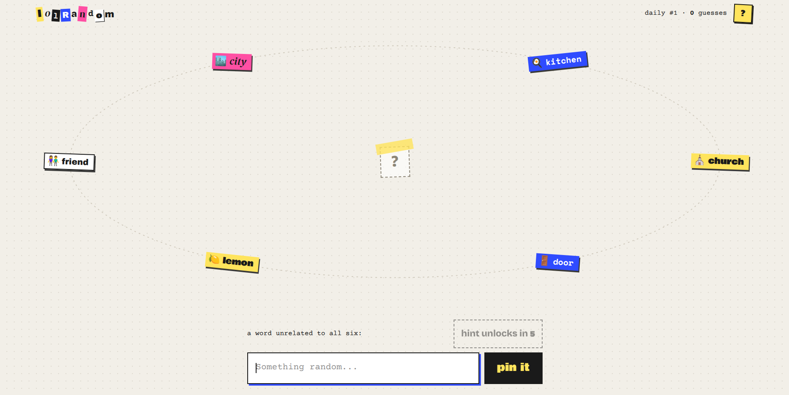

::: {.text-center}
[Play lolrandom ↗](https://lolrandom.onrender.com){.btn .btn-primary .btn-lg 
target="_blank" rel="noopener"}

[Dev timeline ↗](https://lolrandom.onrender.com/devlog){target="_blank" rel="noopener"}
&middot; [Source ↗](https://github.com/SaumiRah/lolrandom){target="_blank" rel="noopener"}
:::

lolrandom is a browser-based game about being random xD

Given a word, think of another word that is as random as possible; a word that isn't 
associated with the given word at all (with some room for error).

The game dons an early 2000s internet scene kid aesthetic. Click the awesome-face in the 
bottom right to get a hint in rawr xD speak \*holds up spork\*.

::: {.callout-note title="WIP"}
This game is in alpha, and will change in the coming months. If you have feedback, email 
me: saumirah@gmail.com
:::

# TODO

## Platform
- [x] Mobile-friendly version.
- [x] Onboarding: three inline illustrations, four short sections, and no
  scrolling on desktop or mobile. The images are inline SVG, so they ship with
  the page rather than needing an asset pipeline.
- [x] `OPENBLAS_NUM_THREADS=1` (plus the OMP/MKL equivalents), set before numpy
  is imported and named in the Dockerfile and `render.yaml`.
- [x] Connection hygiene: a socket timeout and a connection budget that answers
  `503 Retry-After` instead of growing a thread per stalled client.
- [x] Links: website and LinkedIn in the footer, the help panel and `/devlog`.
- [x] Dev timeline page at `/devlog` (`web/devlog.html`), with the roadmap and
  the shipped history.
- [x] Legal: plain-language `/privacy` and `/terms`, an MIT `LICENSE`, and a
  checklist in `docs/memos/legal-checklist.md`. No consent banner: the only
  cookie is strictly necessary.

## Engine
- [x] Bug: State keyed with (mode, seed) so anyone playing the same seed shares one state.
  - [x] Should be keyed with (mode, seed, user-id)
- [x] Bug: didn't finish daily yesterday, picked up at the same state today.
  - A Daily is keyed by its date, the clock is read per request, and a test
    drives it across midnight and past a repeated seed. The fix was already in;
    the test is the thing that keeps it fixed.
- [ ] Experiment with different embedding model?
  - A memo and a concrete benchmark plan are in
    `docs/memos/embedding-models.md`. ConceptNet Numberbatch is the first
    candidate. It needs a new artifact and a recalibrated win cut, so it is a
    project rather than a drop-in.
- [x] Establish database to start producing game statistics. Right now all previous games disapear on restart. Should start collecting any useful data I legally can.
  - SQLite on a Render disk (`LOLRANDOM_DB`). Live runs survive a restart;
    games, guesses and hints are append-only; `python3 -m engine.stats` reads
    them. The statistics store a salted hash, never the cookie.
- [x] Win condition: High score. Each round gets you a higher score and a bigger reaction for how RANDOM you are *waffles*.
  - The score stays "rounds won" and the reaction escalates: a bigger sticker
    burst and a louder rawr-xD line as the chain grows. Per the decision to keep
    the scoring model and add the reward around it.
- [x] Hover/click nodes to reveal neighbouring words for extra information.

## Cosmetic
- [x] Replace nodes with emojis.
  - Deterministic word-to-emoji stickers, with the word label kept; the seed
    has a fixed one because it is the word you did not choose.
- [ ] Scene-theme. Need to create scene-style background. And UI elements.
  - [ ] Add cosmetic interactivity
  - Able to drag the network around (Mario 64)?
  - Deferred to the next pass: the background, the UI elements and dragging are
    one coherent piece of art direction, not three small changes.
- [x] Kerning is too tight on mobile.
- [x] Guess name and marker is currently being drawn under the nodes, make sure its the tallest layer.
- [x] Bug: Incorrect guess bridges need not be circular. It is ugly enough to be considered a bug.
  - It is a gentle dashed arc with the intermediate words on it now. No
    hover-only version and no off-canvas panel: the arc is the explanation.
- [x] Stop using the words "bridge" or "chain", instead use "chain of association".
  - Player-facing copy only: the board, history, help panel and docs say
    "chain of association"; the code, ADRs and CONTEXT.md keep *Bridge* for the
    concept and *Chain* for the player's word list.
- [x] Display total number of words remaining at each round. Very interesting and engaging.
  - The board caption and every history heading show how many Pool words still
    win against the chain.

## Questions/Thoughts
- [x] I'm saving everything in memory right now: this feels like a bad idea.
  - It is SQLite on a disk now, one file, with a fallback to memory if the disk
    cannot be written. Still one process and one disk; that is the trade-off.
  - [x] I don't what what else I don't know.
    - [ ] Should I get a bachelors in comp sci? or the free, online equivalent?
      - `docs/memos/cs-degree.md` has the decision rule keyed to immigration,
        industry, research and indie work. It is a question, not a code change.
- [x] Am I paying too much for a server?
  - `docs/memos/hosting-costs.md`: Render is about $7.25/month; Fly.io is about
    $2.34 for the same shape. Not overcharged, but about 3x the cheapest
    credible option; the memo says when the migration is worth it.
- This long todo list is very exciting, but daunting.

::: {.callout-note title="WIP"}
This game is in alpha, and will change in the coming months. If you have feedback, email
me: saumirah@gmail.com
:::
