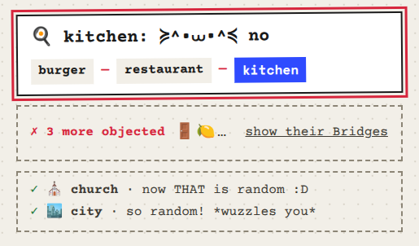

::: {.text-center}
[Play lolrandom ↗](https://lolrandom.lol){.btn .btn-primary .btn-lg 
target="_blank" rel="noopener"}
:::

Given a set of seed words, and semantic embeddings of those words (GloVe) - can you guess which words lie in the space orthogonal to those words? In other words, how "random" are you? You'll be surprsied to see how seemingly unrelated words are semantically similar.

Don't worry - if you guess wrong the game does it's best to explain how the two words are connected using a KNN graph walk.

As more core architectural decisions solidify, I'm writing about what I've learned developing this game and perpetually updating my todo list. Check out the devlog if you're interested: **[the lolrandom devlog ↗](https://lolrandom.lol/devlog)**.