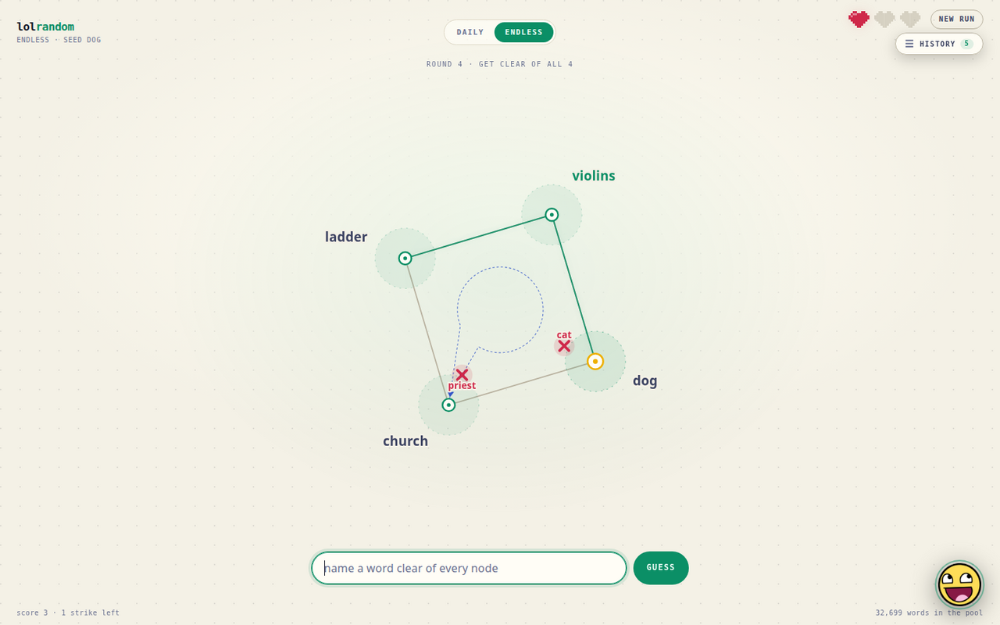

::: {.text-center}
[Play lolrandom ↗](https://lolrandom.onrender.com){.btn .btn-primary .btn-lg target="_blank" rel="noopener"}
:::

::: {.callout-note title="WIP"}
This game is in alpha, and will change in the coming months. If you have feedback, email me: saumirah@gmail.com
:::

lolrandom is a browser-based game about being random xD

Given a word, think of another word that is as random as possible; a word that isn't associated with the given word at all (with some room for error). 

The game don's an early 2000s internet scene kid aesthetic. Click the awesome-face in the bottom right to get a hint in rawr xD speak \*holds up spork\*. 

## TODO

### Bugs
- [ ] Bug: New instance starts on run-over screen for the daily. 
  - [ ] Should start on endless screen for now, and lock daily mode (with a visual lock and mouse-over explanation).
  - [ ] Daily mode
- [ ] Bug: Incorrect guess bridges to nearest word need not be circular. 

## Platform

- [ ] Mobile-friendly version.
- [ ] Onboarding needs images, fewer words.
  - Should NOT have to scroll on desktop or mobile. If Wordle can do it so can I!
  - Hide it in a mouse-over on the guess X? Would rather use remaining space more elegantly.
  - Offset the graph and dedicate an area to printing the bridge? ...

## Cosmetic
- [ ] Replace nodes with emojis.
  - Use the most semantically similar emoji.
- [ ] Scene-theme. Need to create scene-style background. And UI elements.
- [ ] Add comesmetic interactivity
  - Able to drag the network around (Mario 64)

::: {.callout-note title="WIP"}
This game is in alpha, and will change in the coming months. If you have feedback, email me: saumirah@gmail.com
:::
